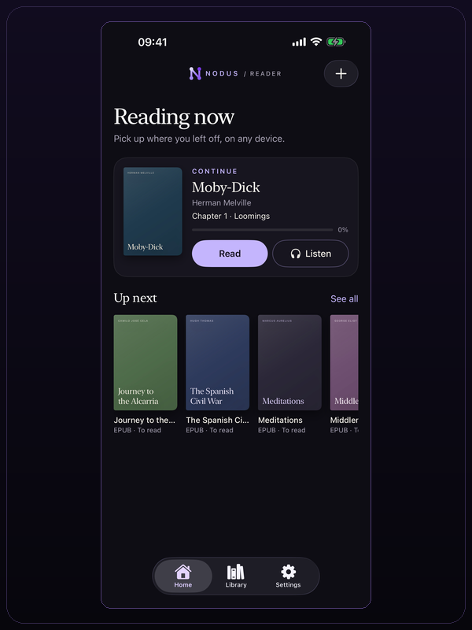
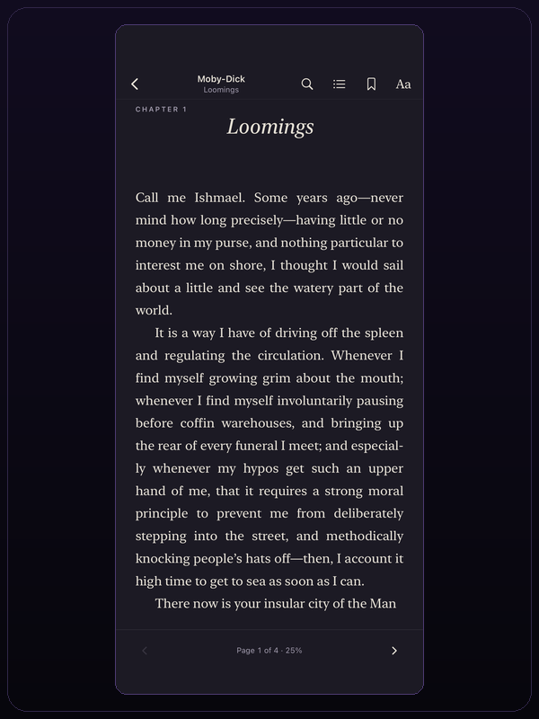
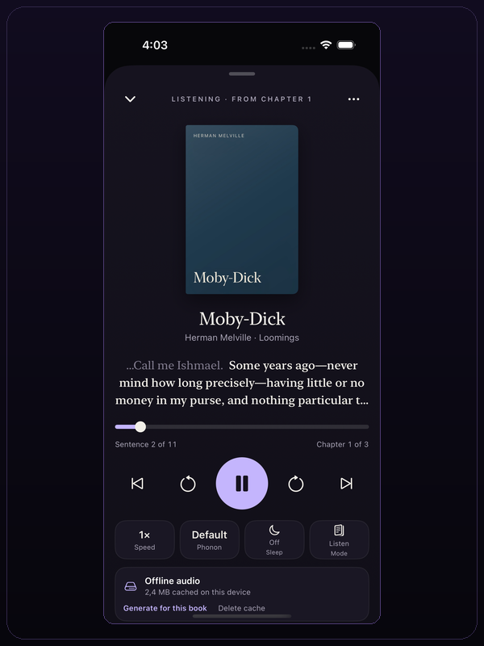
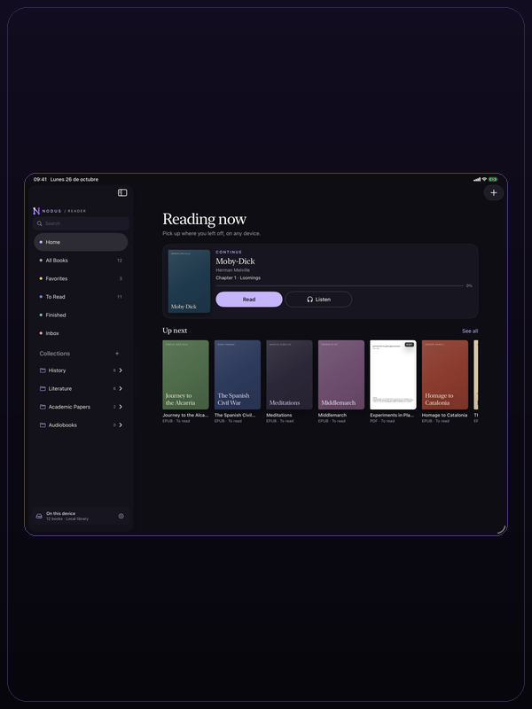
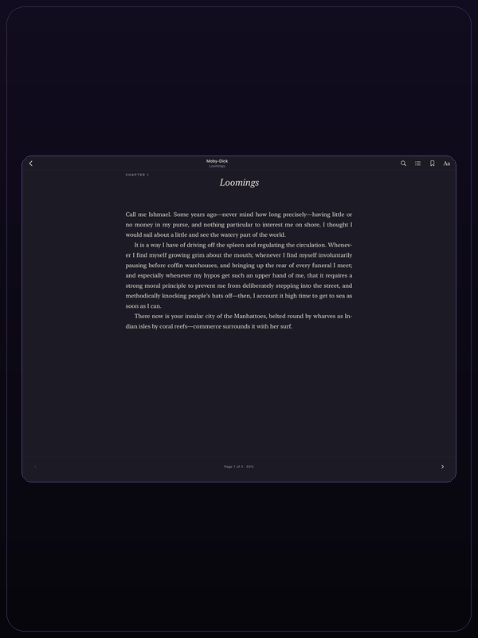
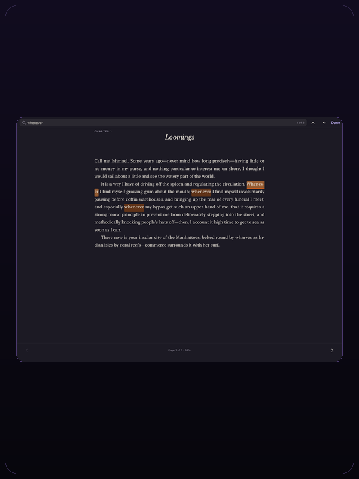
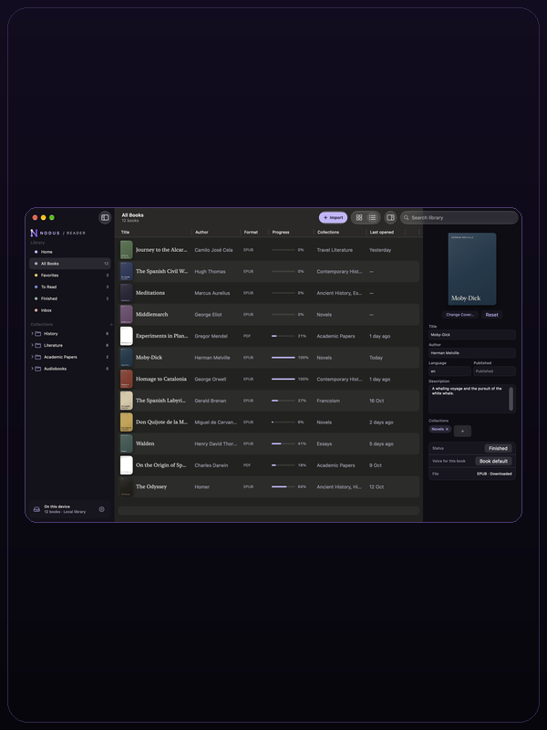
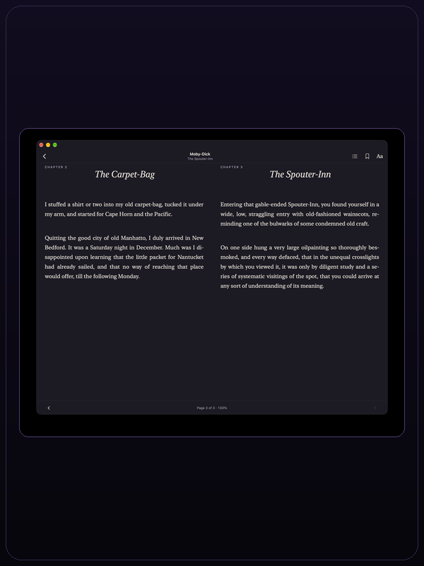
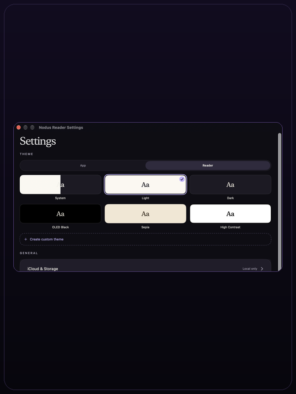

  

  

# Nodus Reader

Nodus Reader is a free, open-source app for listening to your library with voice models that run on your own device. Kokoro and Phonon are available today; more models are coming soon.

It opens EPUB, PDF, TXT, Markdown, HTML and RTF files on iPhone, iPad and Mac.

## Features

- **Import:** open files from Files or Finder, drag and drop them, or share them from another app. Folders are imported recursively. Supported formats are EPUB, PDF, TXT, Markdown, HTML and RTF.
- **Library:** browse books in a grid on iPhone and iPad or a table on Mac. Search titles, authors and document text. Filter by reading status, favorite, collection and format. Create nested collections and assign a book to more than one collection.
- **Reader:** use paged, continuous or two-page reading. Change the theme, typeface, size, line spacing, margins and alignment. Add bookmarks, highlights and notes. Search inside a book and export annotations.
- **PDF:** read the original page layout or switch to Intelligent Reading. Intelligent Reading rebuilds reading order, handles multi-column pages, runs on-device OCR when the text layer is unreadable, keeps tables as page images and provides a page scrollbar.
- **Narration:** read aloud with Kokoro or Phonon. The current sentence and word are highlighted. Tap a word to start Read & Listen from that word. Audio is generated locally and can be cached sentence by sentence. The player includes speed, voice, sleep timer and background playback.
- **Sync:** enable optional iCloud sync through the user's own iCloud account. Library data, reading positions, bookmarks, highlights and notes are synced. Files can also be downloaded on demand.
- **Sharing:** send documents to Nodus Reader from the iOS Share Extension. Choose a collection before the import starts.
- **Privacy:** no remote book or audio processing. Narration models and caches are stored on the device and excluded from backup and sync.
- **Languages:** the interface is available in English and Spanish. Voice languages depend on the installed model.

## Models

Nodus Reader does not use Apple's system voices. Narration requires one of these models. Models are downloaded from Hugging Face, run on the device and are not included in the app or the repository.

| Model | Languages | Voices | Download | Licence |
| --- | --- | ---: | ---: | --- |
| Kokoro 82M | English, Spanish | 31 | About 210 MB | Apache-2.0 |
| Phonon 31M | English | 9 | About 300 MB | Apache-2.0 |
| Phonon 40M Spanish | Spanish | 25 | About 130 MB | CC BY-NC 4.0 |
| Phonon 40M Multilingual | English, Spanish, French, German, Portuguese | 102 | About 150 MB | CC BY-NC 4.0 |

Kokoro provides 28 English voices and 3 Spanish voices. Phonon 31M provides 9 English voices. Phonon 40M Spanish provides 25 voices from Spain and Mexico. Phonon 40M Multilingual provides 102 voices across its five languages.

The two Phonon 40M models require a Hugging Face account that has accepted Gradium's licence. Nodus Reader downloads them with the user's sign-in and converts them to Core ML on the device. They are licensed for non-commercial use under CC BY-NC 4.0; that licence is separate from the app's AGPL-3.0 licence.

Kokoro is not available in the iOS Simulator because its English phonemizer uses MLX and needs a Metal GPU. Use a real device to test Kokoro.

## Voices and languages

- The first launch requires a model download. The setup screen has no skip action and cannot be dismissed until a model is installed.
- Kokoro offers 28 English voices (American and British English) and 3 Spanish voices.
- Phonon 31M offers 9 English voices.
- Phonon 40M Spanish offers 25 Spanish voices.
- Phonon 40M Multilingual offers 102 voices in English, Spanish, French, German and Portuguese.
- Voice selection is stored per book. The player also provides a sample for each installed voice.
- If a saved voice is not installed, the app uses the first voice of the selected model. It does not fall back to a system voice.
- Models, voice files and generated audio are local to the device and are not synced to iCloud.

## Screenshots

All screenshots use the same 600 × 800 frame and the sample library.

### iOS

| Home | Reader | Read & Listen |
| :---: | :---: | :---: |
|  |  |  |

### iPadOS

| Home | Reader | Search |
| :---: | :---: | :---: |
|  |  |  |

### macOS

| Library | Reader | Settings |
| :---: | :---: | :---: |
|  |  |  |

Nodus Reader is licensed under [AGPL-3.0-only](LICENSE). Read [PRIVACY.md](PRIVACY.md) for data-flow details and [MODEL_LICENSES.md](MODEL_LICENSES.md) for model licences.
