# Nodus Reader

**Your library, read aloud.** A free, local-first, open-source reader for iPhone, iPad and Mac with offline narration.

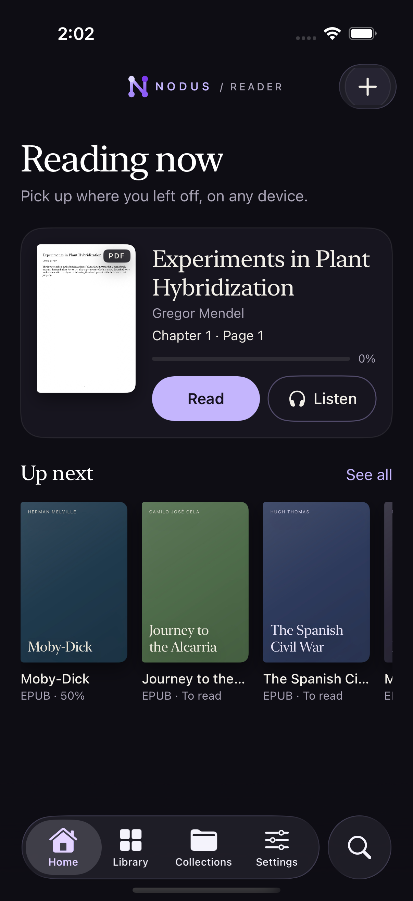

Nodus Reader is part of the Nodus Research ecosystem. It is not a web wrapper: the interface is native SwiftUI, the library is local, and documents are never uploaded to Nodus servers.

## What works in this build

- Universal SwiftUI app for iPhone, iPad and Mac with a shared data layer.
- Native navigation: `TabView` on iPhone, `NavigationSplitView` with a collection tree on iPad and Mac, sortable `Table` and `.inspector` on Mac.
- Library: 3-column iPhone grid, 5-column iPad grid, Mac table/grid, search across titles/authors/text, filters, sorting, favorites, reading status and multi-selection actions.
- Real import from Files/Finder and drag & drop, including whole folders (recursively): EPUB, PDF, TXT, Markdown, HTML and RTF. Set as an alternative handler for those document types.
- Import pipeline: format validation, SHA-256 hashing, duplicate detection, metadata extraction, cover extraction/thumbnail/generation, coordinated file copy and optional collection assignment.
- Covers: embedded EPUB artwork, PDF first-page thumbnails and deterministic typographic covers; custom covers from Photos.
- Collections: unlimited nesting, rename, move, delete-without-deleting-documents, multiple memberships per book, manual order.
- Reader: real EPUB text extraction and TextKit pagination with an iOS page-curl transition, macOS two-page spread, contents, bookmarks, highlights, notes and export, persistent progress, light/sepia/dark/OLED/high-contrast themes, custom themes, typography controls and justified text.
- PDF: original PDFKit reading plus Intelligent Reading with reading-order reconstruction, multi-column detection, Vision OCR fallback, table crops and an original-page overlay.
- Narration: on-device system voices, plus optional Kokoro 82M (English) and Phonon 31M (English) Core ML engines downloaded from Hugging Face. Sentence and word highlighting, tap a word to start Read & Listen from that word, sentence-level audio cache with prefetch, progress, cancellation and deletion, player with transport, speed, voice, sleep timer and modes. Background audio, interruptions, headphone unplugging and lock-screen controls are wired for iOS.
- Sync: optional personal iCloud sync through CloudKit and iCloud Drive, a durable outbox, tombstones, timestamp conflicts, cloud-only badges, download-on-open, `Remove Download` and `Delete from Library`.
- Sharing: iOS Share Extension with an App Group inbox and collection selection.
- Settings: separate App/Reader themes, custom theme editor, reading typography, real voice and model management with downloads/licences/storage, iCloud status and privacy.
- Tests: 27 unit/integration tests plus 9 UI tests with screenshot capture (the Phonon narration test skips when no Phonon bundle is installed in the simulator).

## Screenshots

| iPhone | iPad | Mac |
|---|---|---|
|  | 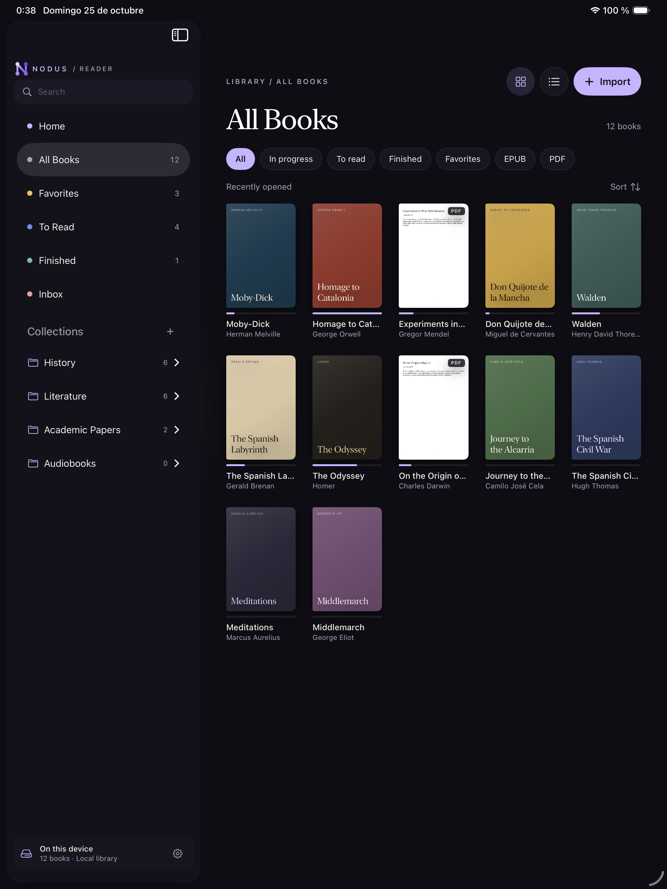 | 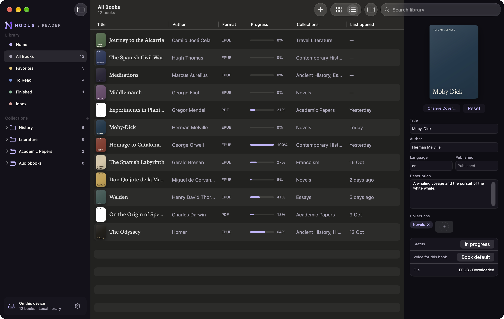 |
| 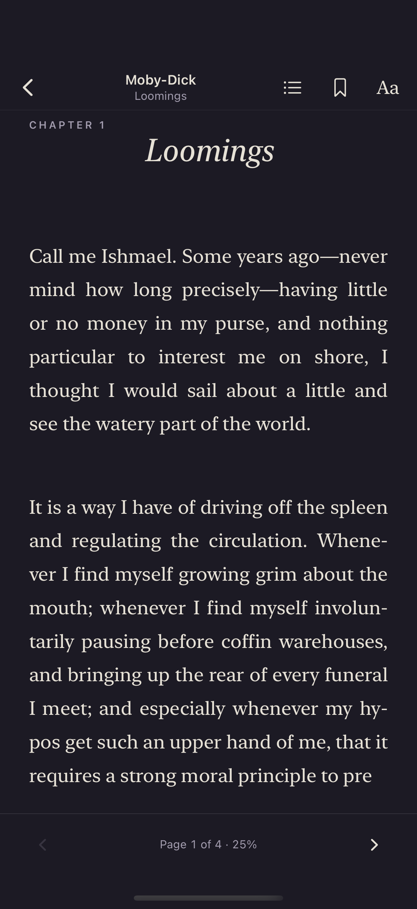 | 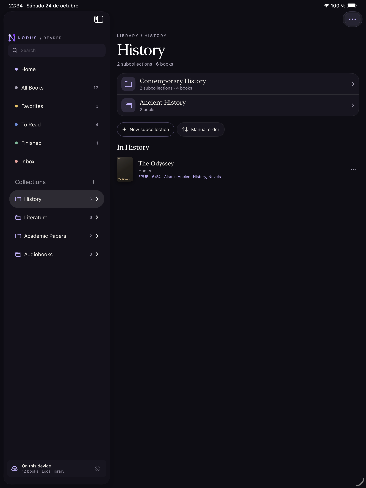 | 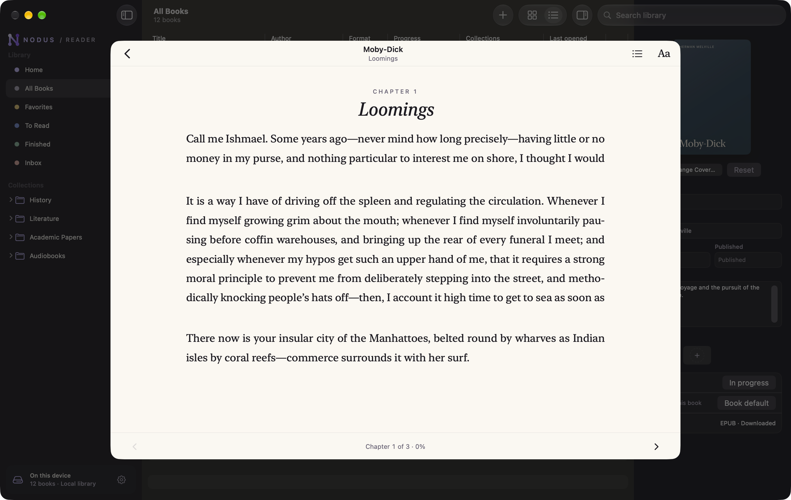 |
| 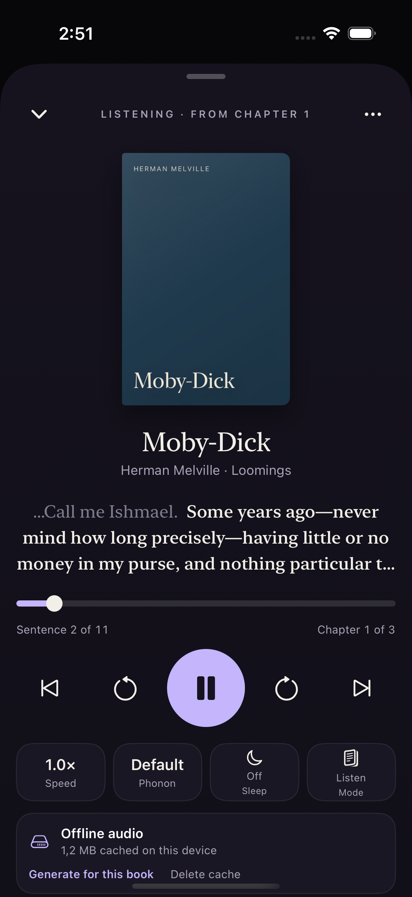 | 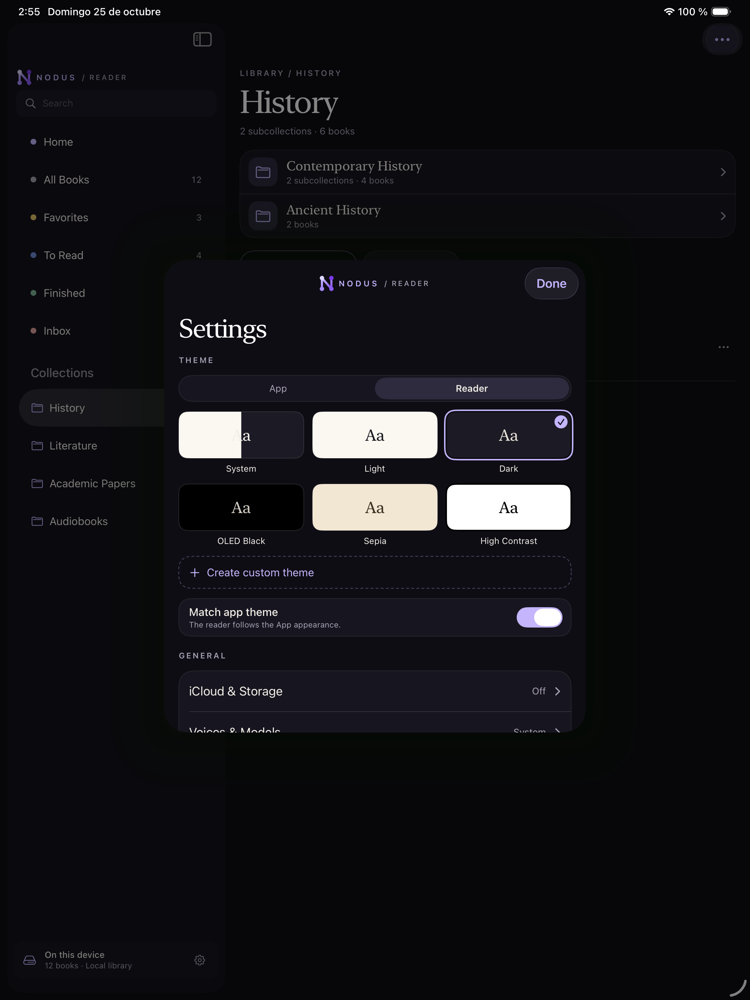 | 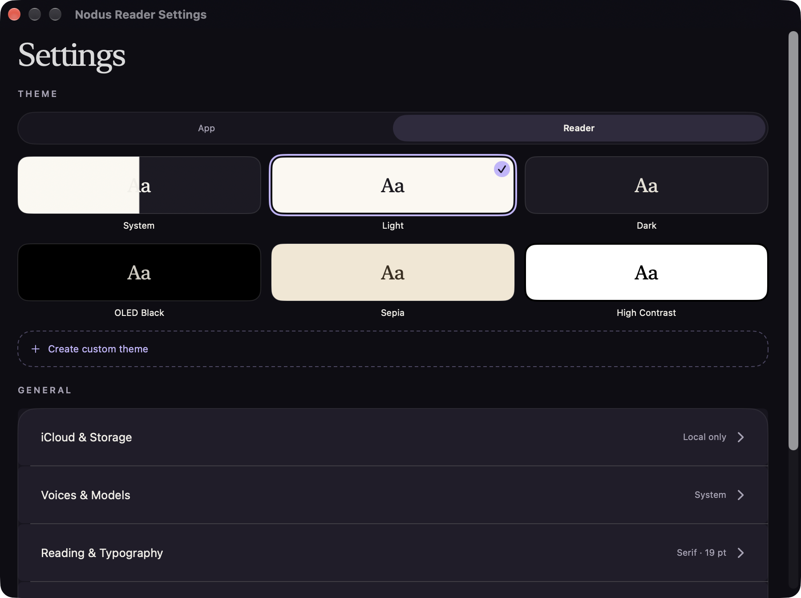 |
|  | 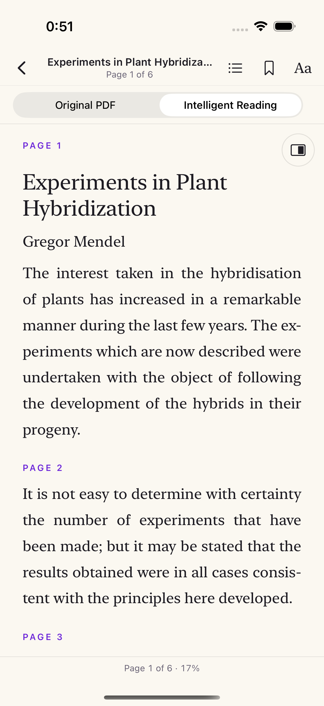 | 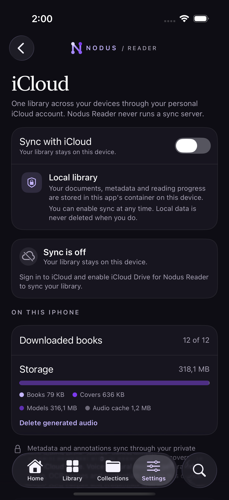 |

The Mac library also has a bottom player bar while narration is active; see `docs/screenshots/Mac-04-Player.png`.

The design source of truth is [`design/DESIGN.md`](design/DESIGN.md) and [`design/screens/`](design/screens/). See [`docs/DESIGN_FIDELITY.md`](docs/DESIGN_FIDELITY.md) for the comparison and documented deviations.

## Known limitations

- **Kokoro is English-only and Simulator-unavailable.** The pinned `KokoroTTS` SDK
  ships English Misaki phonemization, and its MLX phonemizer needs a Metal device.
  The hosted starter bundle contains one voice (`af_heart`).
- **Phonon offers English 31M only.** The Spanish and multilingual 40M checkpoints are
  gated CC BY-NC models without a published Core ML bundle, so they are listed as
  unavailable and never downloaded. Spanish system voices remain available.
- **iCloud requires signed entitlements.** Unsigned simulator builds report iCloud as
  unavailable by design; real-device two-device validation is still required.
- DOCX, FB2, CBZ and other phase-2 formats; DRM-protected content is not supported.
- EPUB locators are chapter/page based, not CFI.
- Interface translations beyond English; strings are localization-ready.
- PDF Original page tap-to-play (Intelligent Reading uses the normal text path).
- App Store/TestFlight distribution, notarisation and the final licence audit.
- Real-device accessibility and large-library performance audits.

See [`docs/ROADMAP.md`](docs/ROADMAP.md) for the full status and deviations,
[`docs/AUDIT.md`](docs/AUDIT.md) for the latest bug audit and remaining risks, and
[`docs/VISUAL_AUDIT.md`](docs/VISUAL_AUDIT.md) for the 2026-10-25 visual pass.

## Build

Requirements: macOS with Xcode 27 (or a compatible Xcode with the iOS 18/macOS 15
SDKs), XcodeGen 2.44+, and network access the first time Swift Package Manager
resolves ZIPFoundation, KokoroTTS/MisakiSwift/MLX and the PhononCore binary. If the
build reports a missing `metal` tool, run `xcodebuild -downloadComponent
MetalToolchain` once.

```bash
xcodegen generate
open NodusReader.xcodeproj
```

Or from the command line:

```bash
xcodebuild -project NodusReader.xcodeproj -scheme NodusReader \
  -destination 'platform=iOS Simulator,name=iPhone 17 Pro' build

xcodebuild -project NodusReader.xcodeproj -scheme NodusReader \
  -destination 'platform=macOS' build
```

Full instructions, test commands and screenshot export are in [`docs/BUILD.md`](docs/BUILD.md).

### Sample library for development

Debug builds accept `-NodusSampleLibrary`, which creates valid EPUB/PDF files, imports them through the production pipeline and seeds collections and reading state. It is debug-only and never runs in release.

```bash
xcrun simctl launch booted ai.nodus.reader -NodusSampleLibrary
```

## Word-level sync and tap-to-play

Narration highlights the current sentence and word, and tapping a word on iPhone/iPad
starts Read & Listen from that word. System voices use native timings; Kokoro and
Phonon use a tested pause-detection and syllable-weighted alignment pass on the real
waveform, with per-sentence audio caching, prefetch, cancellation and deletion.
Models and audio never sync. See
[`docs/NARRATION_SYNC.md`](docs/NARRATION_SYNC.md).

## Tests

```bash
# Unit and integration tests
xcodebuild test -project NodusReader.xcodeproj -scheme NodusReader \
  -destination 'platform=macOS' -only-testing:NodusReaderTests

# UI tests and screenshots
xcodebuild test -project NodusReader.xcodeproj -scheme NodusReader \
  -destination 'platform=iOS Simulator,name=iPhone 17 Pro' -only-testing:NodusReaderUITests
```

## Privacy and licence

- No telemetry, no ads, no accounts, no remote book or audio processing.
- iCloud sync is optional and off by default; it uses only your personal iCloud account.
- Original code: AGPL-3.0-only (see [LICENSE](LICENSE)).
- NodusMark reused under MIT from Nodus Drift; see [THIRD_PARTY_NOTICES.md](THIRD_PARTY_NOTICES.md).
- No model weights are bundled. See [MODEL_LICENSES.md](MODEL_LICENSES.md).
- Read [PRIVACY.md](PRIVACY.md) for the data-flow details.

Nodus Reader is not affiliated with Apple. EPUB is a registered trademark of the IDPF/W3C; PDF is a trademark of Adobe.
