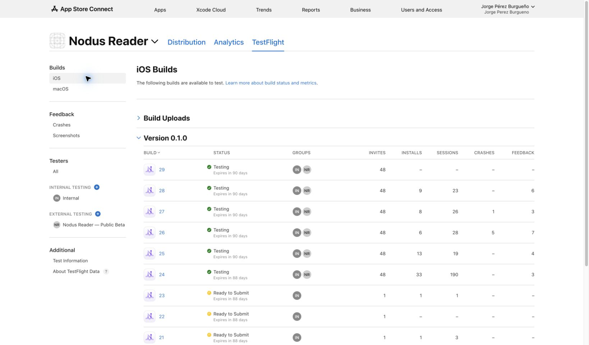
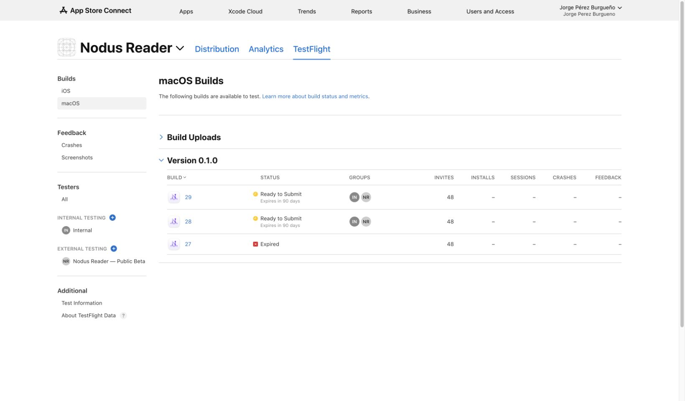

# Build 29 — verification and TestFlight delivery

30 October 2026. Nodus Reader **0.1.0 (29)** was built from the working tree recorded in [BUILD29_SOURCE_FINGERPRINT.txt](BUILD29_SOURCE_FINGERPRINT.txt). This fingerprint records the shipped artifacts; later macOS and description fixes are documented separately in [POST29_MACOS_AND_COPY.md](POST29_MACOS_AND_COPY.md).

## Result

| Platform | Build / delivery ID | Processing | Internal | Public beta |
| --- | --- | --- | --- | --- |
| iOS / iPadOS | `7b916c92-b4df-431b-97e5-0f6288fee35f` | VALID | IN_BETA_TESTING | APPROVED / IN_BETA_TESTING |
| Native macOS | `9a0e97c6-5905-4ae8-8046-815b9d746c57` | VALID | IN_BETA_TESTING | WITHDRAWN / READY_FOR_BETA_SUBMISSION |

Both builds are assigned to **Nodus Reader — Public Beta**. **Internal** has automatic access to all builds. The public link remains [enabled](https://testflight.apple.com/join/SjCk8AZ1). iPhone/iPad builds on Apple silicon Macs remain disabled for both groups; Mac testers use the native app. No App Store production version was submitted.

Apple rejected the first macOS 29 beta-review request because macOS 28 was still waiting in the same review train. The 28 submission was removed through App Store Connect's **Remove from Review** action, preserving that build rather than expiring it. The 29 submission then succeeded on 30 October at 10:35 Europe/Madrid. The user subsequently requested withdrawal of macOS 29. Its review submission was removed, and App Store Connect now shows **Ready to Submit**. It has not been resubmitted. Internal availability is unchanged.

Release notes are stored in [English](TestFlight-29-en.txt) and [Spanish](TestFlight-29-es.txt), and set on both builds in en-US and es-ES. Beta review notes were updated; existing contact details were preserved. Screenshot feedback remains enabled for both groups.

## Feedback included

1. Sentence-only, word-only or combined narration highlighting; saved globally or per book.
2. Optional line-following auto-scroll in Read & Listen, with paused-state and Reduce Motion handling, including Intelligent Reading PDFs.
3. Centred Play/Pause and symmetric transport controls in the reader.
4. Disjoint sentence/word highlight fills and no vertical expansion into adjoining lines.
5. No underline on the narrated word.
6. Decorative-rule and non-narratable sentence filtering before synthesis, prefetch and offline audio generation, preserving original UTF-16 offsets.
7. A durable pause cursor containing sentence text/start, character offset, voice and audio time; visual page saves preserve it. Cached audio resumes at that instant; changed voice/text or an evicted cache falls back to the word. Older sessions lack a precise timestamp until a new pause is saved.
8. Per-book voice/model resolution across every installed model, independent of the global model. Missing-model fallbacks preserve the book's saved choice.

## Verification

Counts below are test functions; parameterized cases may produce additional executions.

| Check | Result | Evidence under `build/` |
| --- | --- | --- |
| Final iPhone units and process-relaunch regression | 95 units + 1 UI passed; 10 opt-in model cases skipped | `Build29-ResumeAndUnits-iPhone.xcresult` |
| Complete iPhone UI suite | 18 passed, 2 platform/opt-in skips, 0 failures | `Build29-UI-iPhone.xcresult` |
| macOS units | 94 passed, 10 opt-in skips | `Build29-Unit-macOS.xcresult` |
| Native Mac line-following regression | 1 passed | `Build29-Mac-NarrationScroll.xcresult` |
| iPad units and selected UI suite | 94 units + 4 UI passed; 10 opt-in and 1 iPhone-only skip | `Build29-iPad.xcresult` |
| iPad native line-following and process-relaunch regression | 2 passed | `Build29-iPad-ResumeAndScroll.xcresult` |
| DesignSystem | 1 passed | `build29-designsystem.log` |
| Localization | 710 keys, 0 missing Spanish, 0 placeholder mismatches | `gencat.py` audit of simulator and final archive intermediates |
| Source whitespace | `git diff --check` passed | Working tree |

The new regressions cover rule skipping and original offsets, non-overlapping/underline-free highlights, persisted preferences and legacy decoding, pause restoration after controller recreation, preservation through visual page saves, per-book voices across global model changes, native viewport following, selection suppression and centred playback UI. The Mac viewport test waits for released mouse input and checks the comfortable reading band because AppKit can align scrolling to text lines.

UI narration tests exercised playback with the app player volumes fixed to zero through the DEBUG-only `-NodusSilentAudioTests` flag. That flag was confirmed absent from both Release executable binaries. The computer's sound was not activated. No subjective listening/audio-quality check was performed.

## Signed Release startup and artifacts

- Both final archives succeeded with build number 29 and automatic signing for team `6RPLS9EA4X`.
- The final signed native Mac archive app passed strict code-signature verification, opened and responded to opening the model catalogue through its accessibility UI. Architecture: arm64; minimum macOS: 15.0.
- A signed Release Simulator build (29) launched successfully on iPhone 17 Pro and iPad Pro 13-inch M5, iOS 26.5. Home/library screenshots were inspected.
- Xcode initially failed with a disk-I/O error in the repository-local simulator build database. The successful final simulator build reused the cache outside Documents at `/tmp/nodus-reader-build28-ios`; the cache name is historical, and the app's Info.plist was explicitly verified as build 29.
- The Mac installer signature was verified. The exported iOS IPA and Mac PKG uploaded without errors and subsequently reached VALID in App Store Connect.
- No physical-iOS-device or macOS 15.8 startup check was available in this run.

Artifacts: `NodusReader-iOS-0.1.0-29.xcarchive`, `NodusReader-macOS-0.1.0-29.xcarchive`, `export-ios-29/Nodus Reader.ipa`, `export-macOS-29/Nodus Reader.pkg`. Final API state is in `build/TestFlight-29-deployment.json`; the source patch is `build/Build29-source.patch`. App-source and distribution hashes are in the fingerprint linked above.

