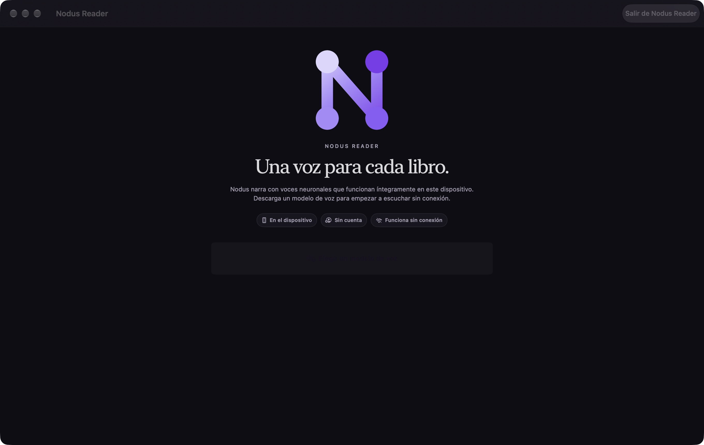

# macOS library and setup fixes after build 29

30 October 2026. These source changes follow the uploaded build 29 and are **not included in that binary**. The original build-29 source/artifact fingerprint remains unchanged.

## Review hold

At the user's request, native macOS build `9a0e97c6-5905-4ae8-8046-815b9d746c57` was removed from Apple Beta App Review. App Store Connect confirms **Ready to Submit** (`READY_FOR_BETA_SUBMISSION`) with no pending review submission. It was not expired or resubmitted. Internal access is unchanged. iOS/iPadOS 29 remains approved and in public/internal testing. No App Store production version was submitted.

## Source changes

- Explicit development sample launches and XCTest hosts use a separate SwiftData store, file/audio directories and preference suite. They cannot enable iCloud sync or consume personal Share Extension imports. Normal and Release launches retain the personal library.
- macOS startup recognizes legacy fixture EPUBs by exact generated chapter fingerprints and sample PDFs by their generator metadata and UUID filenames. A title match alone never removes a document. Files, covers, reading preferences, bookmarks, notes and collection metadata are backed up under the app-private `NodusReader/LegacySamplesBackup/<migration-id>/` before removal. If backup fails, cleanup stops without deleting anything.
- Only recognizable empty seed collections are pruned. Personal documents, custom descendants and their parent collections are preserved. A fresh normal installation starts empty; samples remain DEBUG-only and opt-in.
- macOS voice setup is regular window content, so it does not block normal termination. A localized **Quit Nodus Reader** button is available on the setup page; standard ⌘Q also works from the model catalogue without installing a model.
- English and Spanish app/privacy/documentation copy describes on-device processing and storage and optional personal iCloud synchronization. TestFlight's English beta description and both English/Spanish App Store draft descriptions for iOS and macOS were updated through App Store Connect and read back to verify exact values. This did not submit an App Store version or send macOS back to review.

## Verification

- macOS: 98 unit/integration test functions passed, 10 opt-in model tests skipped (`build/Post29-Mac-Units-2.xcresult`).
- iPhone: 98 unit/integration test functions passed, 10 opt-in model tests skipped (`build/Post29-iPhone-Units.xcresult`). Parameterized tests account for 116 passing runs on each platform.
- Additional macOS isolation check passed (`build/Post29-Mac-Isolation.xcresult`), verifying the actual XCTest host uses the separate store path.
- Migration tests cover all twelve original sample files, a distinct imported edition with the same title, personal collection membership, retained notes in the backup, repeat execution and a failed backup that leaves the library untouched.
- The current native macOS app launched successfully. Clicking **Salir de Nodus Reader** terminated the process without installing a model. After relaunch, opening the catalogue and pressing ⌘Q also terminated normally. Neither check played audio.
- Localization regenerated from current Debug iOS/macOS compiler extraction: 706 keys, zero missing Spanish and zero placeholder mismatches. Historical archive extraction was excluded because it contains the replaced copy.
- Original build-29 unit/UI, iPad, signed archive and TestFlight checks are recorded in [BUILD29_VERIFICATION.md](BUILD29_VERIFICATION.md).

The updated macOS code still requires a new binary and distribution verification before a future release. macOS remains out of Apple review until the user explicitly requests resubmission.
