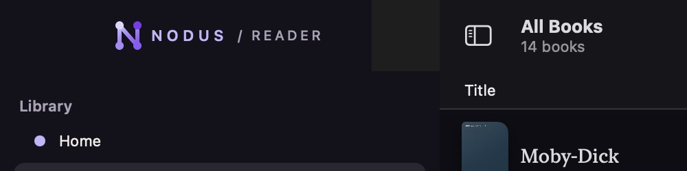
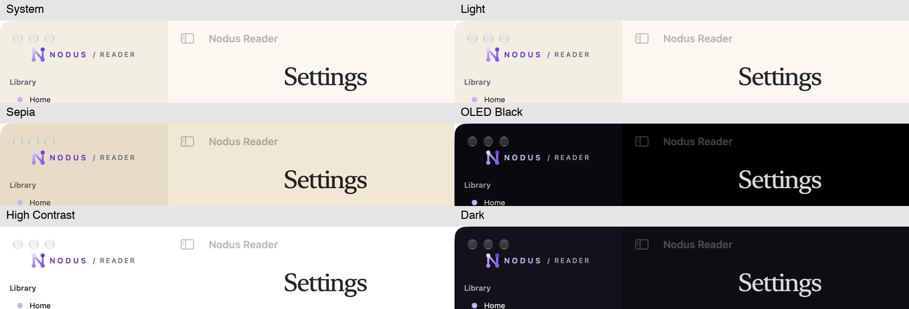

# Reader corrections — end-of-day handoff

Work is saved on `codex/player-fixed-header`. The user explicitly stopped Mac visual testing on 5 November and requested that all changes be pushed to GitHub. Do not describe the remaining Mac rectangle as fixed or merge this unfinished Mac work automatically.

## Changes implemented

- Keep the expanded player's close/options header outside the scrolling content on iOS, iPadOS and macOS.
- Suspend automatic narration following on manual scrolling, keyboard/page navigation, opening search or contents. Narration continues. Only an explicit Return to narration or word-start action resumes following.
- Invalidate queued native scrolls and delayed search results when navigation intent changes. Remove competing search/page jumps and passive browsing seeks. Handle EPUB continuous/paged rendering and original/reflow PDF routes.
- Center the sidebar brand, retain contrast with the app palette and cap its native split-view width at 320 pt (minimum 244 pt; native collapsing remains available).
- Paint the sidebar through the titlebar area, remove the extra empty header strip, and leave room below window controls at the minimum width. Resolve the app's System theme independently of the reader's window preference; observe application appearance changes.
- Increment the next beta to 0.1.0 (57) and add English/Spanish test notes.

## Completed checks and limits

- iOS Debug build-for-testing passed from an isolated source snapshot.
- **239 tests in 2 suites passed**, including the three new follow/search intent cases. Local result: `build/build57-unit-ios.xcresult`; log: `build/build57-unit-ios.log`.
- Multiple Mac Debug builds passed. Temporary native-view diagnostic logging was removed before committing; no UI testing continued after the user's stop instruction.
- Visually inspected all six app themes, library/reader transitions, different app/reader themes, minimum/maximum widths, collapse/reopen, windowed/full-screen modes and first-row visibility. These checks found the remaining issue below; this is not a blanket UI pass.
- Physical iPhone/iPad testing remains explicitly deferred. Full end-to-end follow/search/player playback regression checks remain for the next session. No new production App Store submission is authorized or performed.

## Mac issue still open

A roughly 50 pt wide native-colored rectangle remains at the **upper trailing edge of the sidebar**, most visibly in All Books in full screen at a 320 pt sidebar width. The brand itself is visible and centered, and the large empty strip is gone. The main toolbar now changes with the app theme, but this small native backing area remains.

Current investigation evidence:

- AppKit moves the native toolbar items into a separate full-screen window. Access it through the public `window.toolbar?.items` → `item.view?.window` relationship; avoid private selectors/class-name-dependent production code.
- The full-screen toolbar window was already non-opaque with a clear `backgroundColor`. Setting only the owning window's `titlebarAppearsTransparent`, opacity or background did **not** remove the rectangle.
- Inspect the full-screen toolbar's content/background geometry and its sidebar tracking separator before choosing the next fix. The suspected backing starts around x=270 pt while the visible sidebar ends at x=320 pt.
- No clipping/masking fix has been implemented yet. Preserve native full-screen window controls if testing such an approach.
- Local diagnostic evidence: `build/sidebar-chrome-inspect2.log`; local screenshots: `build/sidebar-visual/`. The six-theme contact sheet below predates the final native-backdrop investigation and is contrast evidence, not proof that the residual rectangle is fixed.

## Detached iOS 57 delivery

The user separately authorized **iOS Internal + Public Beta**, running while Mac work continued. Do not start a second upload or wait for a Mac visual gate.

- Worker: `build/deliver57-ios.py`, launched detached under `caffeinate -i`; process metadata: `build/build57-ios-worker.json`.
- Status: `build/build57-ios-status.json`; log: `build/build57-ios-worker.log`.
- Source: immutable `/tmp/nodus-reader-ios57-source`; manifest: `build/build57-ios-source.json`. Subsequent Mac edits do not change this build.
- At handoff the 239 tests had passed and the signed iOS Release archive was running.
- Automation then exports, verifies signature/licences/Production CloudKit, uploads once, waits for Apple processing, assigns Internal/Public Beta, saves bilingual notes, and submits **beta** review only if needed. Public availability still depends on Apple.
- Receipt on completion: `docs/appstore/BUILD57_IOS_DELIVERY.json`. The follow-up recorder commits/pushes the delivery status/receipt and updates the draft PR, without merging it.
- Audit copies of the automation are tracked in `tools/appstore/`. The running worker uses its already-loaded local scripts. Do **not** rerun the one-shot worker while it is active or when build 57 already exists; inspect Apple and the status first.

## Next session

1. Read the delivery receipt/status; never reupload a build merely because processing is slow.
2. Finish the small Mac full-screen backing rectangle and verify screenshots before marking the Mac fix complete.
3. Run the remaining reader follow/search/player runtime regressions across EPUB/PDF/text and supported platforms.
4. Review the draft PR and final checks before any merge or new Mac distribution. Build 56 remains the last completed Mac private beta.
